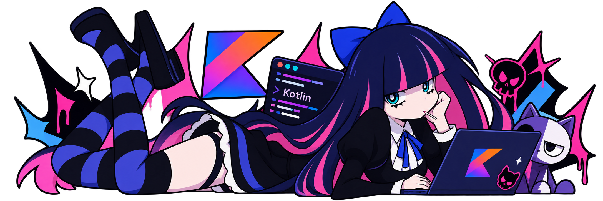

# José V.

### Hola, soy Josexo

---

## Sobre mí

- Desarrollo principalmente en Python y Kotlin, con foco en apps para Android.
- Aprendo haciendo: cada proyecto es una excusa para probar algo nuevo.
- Me gusta entender el porqué de las cosas, no solo que funcionen.

---

## Stack

**Lenguajes**

**Ecosistema Android & UI**

**Herramientas & Entorno**

---

## Estadísticas

<table align="center">
  <tr>
    <td align="center">
       
      
    </td>
    <td align="center">
      
    </td>
  </tr>
  <tr>
    <td align="center" colspan="2">
      
    </td>
  </tr>
</table>

---

## Actividad

---

## Contacto

*"El código no siempre compila a la primera, pero nunca hay que rendirse."*

